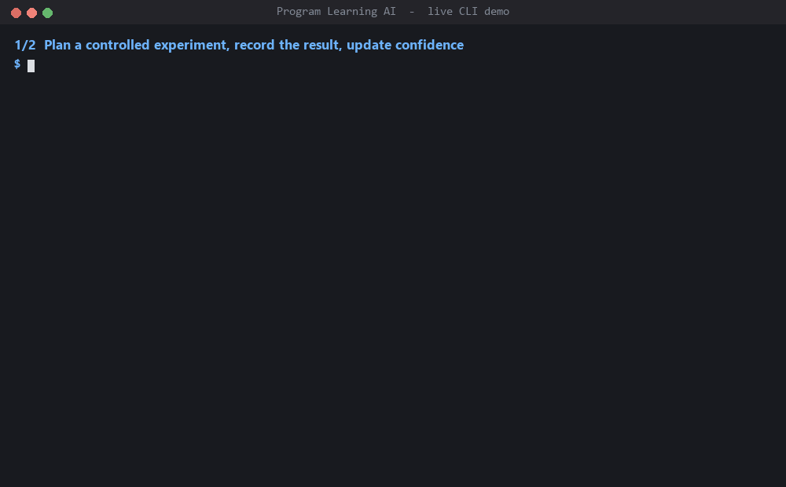
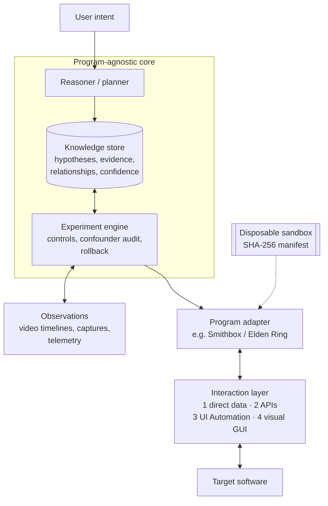

# Program Learning AI

**An AI system that learns how unfamiliar software works by running controlled
experiments, and keeps only conclusions the evidence supports.**

It acts as a scientist. It proposes a hypothesis, changes one variable in a
disposable copy, observes what happens, and records a causal relationship with
a confidence that matches the evidence. Failed and no-effect results are kept
too.

The first target is a game modding toolchain (Smithbox for Elden Ring), used as
a training ground. The learning core is program-agnostic. Everything specific
to that game lives in a replaceable adapter.

> This is a public showcase. The full source is in a private repository and is
> available on request.

*The real `plai` CLI in a scratch folder. Scene 1 records EXP-0001's actual
results: a wall did not reduce the enemy response, so the hypothesis drops from
50% to 30% confidence. Scene 2 shows that an edited experiment copy is detected
while the protected baseline still verifies. Local paths are shortened to `.\`.*

---

## What works today

- **Experiment engine.** Hypotheses, experiments, trials and observations are
  stored as a versioned JSON knowledge document with JSON Schemas.
- **Confounder audit.** Before two trials are compared, the engine checks that
  the variables the experiment requires to match actually matched. It reports
  any mismatches or missing evidence.
- **Disposable sandboxes.** Experiments run only on verified copies. Every
  copied file is recorded with its SHA-256 hash, and the trusted manifest is
  stored outside the folder the experiment can change.
- **Observation tooling.** A browser-based observer records video timelines
  with phase markers (arrival, investigation start, departure), plus
  before/after screenshot and video capture.
- **Program adapter #1.** Readers for the game's structured data files, so the
  system reads data directly instead of driving the GUI.
- **Tests.** 57 Python test files and 2 JavaScript test files, including
  checks that each experiment protocol rejects tampered or out-of-scope input.

## What's planned

- Assisted execution through OS APIs and Windows UI Automation.
- Visual observation and control for interfaces with no machine-readable
  access.
- Autonomous experiments in parallel, each worker isolated in its own sandbox,
  with evidence merged centrally.

---

## Architecture

**Program Learning AI is the scientist. The interaction layer is its eyes and
hands.** Keeping the two apart means a control technology can be swapped out
without touching the learning system.

The interaction layer always uses the most direct reliable method it can, in
this order:

1. **Direct data access:** structured files, exports, project data.
2. **Program or OS APIs:** command-line tools, native interfaces.
3. **Windows UI Automation:** accessible interface controls.
4. **Visual GUI automation:** screenshots plus mouse and keyboard, only as a
   last resort.

Direct data is faster, easier to verify, and doesn't break when a layout
changes. Desktop-agent research (UFO², UI-TARS) shaped the lower layers. These
projects are optional providers behind an interface, and the core never depends
on them.

More detail: [docs/architecture.md](docs/architecture.md).

---

## The learning loop

1. State a **falsifiable hypothesis**.
2. Declare the **controlled variables**, the baseline, and how to roll back.
3. Run the change in a **disposable sandbox**. Originals stay read-only.
4. Record **structured observations**, split into phases so that travel time is
   never mistaken for the effect being measured.
5. **Audit the comparison** for confounders before trusting it.
6. Update **confidence from the evidence**, and keep qualifiers such as "single
   experiment; replication required".

A worked example, from question to causal mapping:
[docs/worked-example.md](docs/worked-example.md).

---

## Working with AI coding agents

The project is built with two AI coding agents (OpenAI Codex and Anthropic
Claude) sharing one repository. Much of the engineering went into keeping them
reliable:

- **One write owner at a time.** A handoff file records who owns writes, what
  is done, what is pending, and the next concrete action. An agent that isn't
  the owner stays read-only.
- **A threshold for using a second model.** The second model is brought in only
  when it can make a specific, independent contribution, e.g. when a mistake
  could invalidate evidence. Routine work stays with one model.
- **Blind review.** The reviewer sees the requirements, the diff and the test
  results, but not the first model's reasoning. Each finding must cite evidence.
- **Grounding rules and locks.** Agents may not edit sealed data, test
  assertions or manifests to make a check pass. Numbers in reports must come
  from stored files. Protected files are locked at the OS level, and a separate
  sentinel watches for changes.

More detail: [docs/agent-workflow.md](docs/agent-workflow.md).

---

## Evidence discipline

- Experiments are **pre-registered and frozen** before data is collected, and
  hash-bound so a protocol can't be quietly changed afterwards.
- Earlier experiments' data is **protected read-only input** for later ones.
- **Failed, excluded and no-effect results are kept** as evidence.
- Conclusions are never stretched beyond the experiment's registered scope.

---

## Code excerpts

- [excerpts/sandbox.py](excerpts/sandbox.py): verified disposable copies with
  SHA-256 manifests, a trusted manifest kept outside the sandbox, and guards
  against paths escaping the sandbox.
- [excerpts/confounder_audit.py](excerpts/confounder_audit.py): checks that two
  trials actually match on the variables the experiment requires before they
  are compared.

---

## Limitations and next steps

- **Live validation is paused, on purpose.** The latest pre-registered
  validation (EXP-0024) was stopped before capture. Smoke tests showed the
  existing telemetry method noticeably slowed the game, which would have
  contaminated the measurements. A lower-overhead, read-only telemetry provider
  is being qualified (EXP-0025) before any capture resumes.
- Observation is still partly human-assisted, through reviewed video markers.
- Only one program adapter exists so far.

---

## Tech stack

Python 3.11+ · JavaScript (Node, browser) · PowerShell · pytest · JSON Schema ·
OBS for recording · Windows UI Automation (planned)

## Contact

Dylan Sabulsky · [LinkedIn](https://www.linkedin.com/in/dylan-sabulsky-35332388/) · dylansabulsky@gmail.com
